# 先说两句

最近打算考个驾照，为了方便备考，准备总结记录一下考点。(本文大部分内容由AI生成)

# 一、考试内容与答题技巧

> 科目一为理论考试：共 100 题，每题 1 分，满分 100 分，**90 分及格**，考试时间 **45 分钟**。
> 题型为判断题和单选题，内容以道路交通安全法律法规、交通信号、安全文明驾驶常识为主。
> 法规会更新，本文以现行《道路交通安全法》及《道路交通安全违法行为记分管理办法》（2022 年 4 月 1 日施行）为主，实际以当地车管所最新规定为准。

## 1. 考试范围
- 道路交通安全法律、法规和规章
- 交通信号（信号灯、标志、标线、交警手势）
- 安全行车、文明驾驶基础知识
- 机动车驾驶操作相关基础知识
- 地方性法规（部分地区）

## 2. 答题技巧
- **安全第一**：凡是“减速、让行、停车、观察、保持车距”的选项，一般正确。
- **礼让优先**：行人、非机动车、校车、特种车辆优先。
- **不冒险**：急加速、急刹车、强行超车、占用应急车道一般错误。
- **看清绝对词**：出现“可以随意”“立即加速”“不用观察”等绝对表述多为错误。
- **数字题分类记**：速度、距离、时间、罚款、记分是高频失分点。
- **判断题看关键词**：“必须”“不得”“严禁”多为正确；“可”“随意”需警惕。

---

# 二、驾驶证管理

## 1. 准驾车型
- **C1**：小型汽车（手动挡），可驾驶 C2、C3、C4 准驾车型。
- C2 为小型自动挡汽车，不能驾驶手动挡小型汽车。

## 2. 申请条件
- 年龄：**18 周岁以上**（C1 无上限，但 70 周岁以上需每年体检并提交身体条件证明）。
- 视力：两眼裸眼或矫正视力达到对数视力表 **4.9 以上**。
- 辨色力：无红绿色盲。
- 听力、上肢、下肢、躯干颈部符合规定。
- 有器质性心脏病、癫痫、精神病、痴呆等妨碍安全驾驶疾病的，不得申请。

## 3. 实习期
- 初次申领驾驶证后 **12 个月** 为实习期。
- 实习期内驾驶机动车，应在车身后部粘贴或悬挂**统一式样的实习标志**。
- 实习期内**不得独自驾驶机动车上高速公路**，需由持相应或更高准驾车型驾驶证 **3 年以上** 的驾驶人陪同。
- 实习期内记满 **12 分** 的，**注销**其实习的准驾车型驾驶资格。

## 4. 有效期与换证
- 驾驶证有效期分为 **6 年、10 年、长期**。
- 有效期满前 **90 日内** 到车管所申请换证。
- 6 年有效期内每个记分周期均未记满 12 分的，换发 10 年有效期驾驶证；10 年内每个记分周期均未记满 12 分的，换发长期有效驾驶证。
- 信息发生变化（姓名、住址等）应在 **30 日内** 备案。

## 5. 审验与体检
- C1 驾驶证一般**不需要每年审验**。
- 发生交通事故造成人员死亡且承担同等以上责任、未被吊销驾驶证的，应在记分周期结束后 **30 日内** 接受审验。
- **70 周岁以上** 驾驶人每年提交一次身体条件证明，并需通过记忆力、判断力、反应力测试。

## 6. 记分周期
- 记分周期为 **12 个月**，从初次领证之日起计算。
- 一个记分周期内记分未达到 12 分且罚款已缴纳的，记分予以清除。
- 记分达到 12 分的，扣留驾驶证，参加 **7 日** 学习并考试科目一；两次以上达到 12 分或累积记分达到 **24 分以上** 的，还需考试科目三。

---

# 三、交通违法行为记分（重点）

> 2022 年新规：记分调整为 **12 分、9 分、6 分、3 分、1 分** 五档，取消了 2 分档。

## 1. 一次记 12 分
- 饮酒后驾驶机动车。
- 造成致人轻伤以上或死亡的交通事故后逃逸，尚不构成犯罪。
- 使用伪造、变造的号牌、行驶证、驾驶证、校车标牌，或使用其他车辆的号牌、行驶证。
- 在高速/城市快速路上**倒车、逆行、穿越中央分隔带掉头**。
- 代替实际驾驶人接受处罚和记分牟取经济利益（“买分卖分”）。
- 超速、超载达到 12 分档的情形见本章第 6、7 节表格。

## 2. 一次记 9 分
- 在高速公路或城市快速路上**违法停车**。
- 驾驶**未悬挂号牌**或**故意遮挡、污损号牌**的机动车。
- 驾驶与准驾车型**不符**的机动车。
- 未取得校车驾驶资格驾驶校车。
- 连续驾驶中型以上载客汽车、危险物品运输车辆超过 **4 小时** 未停车休息，或停车休息少于 **20 分钟**。
- 超速、超载达到 9 分档的情形见本章第 6、7 节表格。

## 3. 一次记 6 分
- 运载危险物品未按规定时间、路线、速度行驶，或未悬挂警示标志、未采取安全措施。
- 运载超限不可解体物品未按规定行驶或未悬挂明显标志。
- 危险化学品运输车辆未经批准进入限行区域。
- **不按交通信号灯指示通行**（闯红灯）。
- 驾驶证被**暂扣或扣留期间**驾驶机动车。
- 造成致人轻微伤或财产损失的交通事故后逃逸，尚不构成犯罪。
- 在高速/城市快速路行驶**低于规定最低时速**。
- 超速、超载、超重达到 6 分档的情形见本章第 6、7、8 节表格。

## 4. 一次记 3 分
- 在高速/城市快速路上**不按规定车道行驶**。
- **不按规定超车、让行**，或在高速/快速路以外道路**逆行**。
- 遇前方车辆排队或缓慢行驶时，**借道超车、占用对面车道、穿插等候车辆**。
- **拨打、接听手持电话**等妨碍安全驾驶的行为。
- 行经人行横道**不按规定减速、停车、避让行人**。
- **不按规定避让校车**。
- 驾驶未定期检验的公路客运、旅游客运、危险物品运输车辆上道路行驶。
- **不按规定设置警告标志**。
- 超速、超载、超重达到 3 分档的情形见本章第 6、7、8 节表格。

## 5. 一次记 1 分
- 不按规定**会车**，或在高速/快速路以外道路不按规定**倒车、掉头**。
- 不按规定**使用灯光**。
- 违反**禁令标志、禁止标线**指示。
- 驾驶未定期检验的其他机动车上道路行驶。
- 驾驶擅自改变已登记结构、构造或特征的载货汽车。
- 驾驶人**未按规定系安全带**。
- 驾驶摩托车**不戴安全头盔**。
- 超速、超载、超重达到 1 分档的情形见本章第 6、7、8 节表格。

## 6. 超速记分表

### （1）重点车辆：校车、中型以上载客载货汽车、危险物品运输车辆

| 道路类型 | 超速比例 | 记分 |
| --- | --- | --- |
| 高速/城市快速路 | 未达 20% | 6 分 |
| 高速/城市快速路 | 20% 以上 | 12 分 |
| 其他道路 | 10%—20% | 1 分 |
| 其他道路 | 20%—50% | 6 分 |
| 其他道路 | 50% 以上 | 9 分 |

### （2）其他机动车

| 道路类型 | 超速比例 | 记分 |
| --- | --- | --- |
| 高速/城市快速路 | 20%—50% | 6 分 |
| 高速/城市快速路 | 50% 以上 | 12 分 |
| 其他道路 | 20%—50% | 3 分 |
| 其他道路 | 50% 以上 | 6 分 |

> 说明：超速 50% 以上的，还可处 **200—2000 元**罚款，并可并处**吊销**驾驶证。未达到记分档的，一般给予警告或罚款，不记分。

## 7. 超载（超员）记分表

### （1）校车、公路客运汽车、旅游客运汽车

| 超过核定人数比例 | 记分 |
| --- | --- |
| 未达 20% | 6 分 |
| 20% 以上 | 12 分 |

### （2）7 座以上载客汽车

| 超过核定人数比例 | 记分 |
| --- | --- |
| 20%—50% | 6 分 |
| 50%—100% | 9 分 |
| 100% 以上 | 12 分 |

### （3）其他载客汽车

| 超过核定人数比例 | 记分 |
| --- | --- |
| 20%—50% | 3 分 |
| 50%—100% | 6 分 |
| 100% 以上 | 12 分 |

> 说明：校车、公路客运汽车、旅游客运汽车以外的载客汽车，超员未达 20% 的，不记分，但可依法罚款。

## 8. 超重（载货）记分表

### （1）载货汽车超过最大允许总质量

| 超过最大允许总质量比例 | 记分 |
| --- | --- |
| 未达 30% | 1 分 |
| 30%—50% | 3 分 |
| 50% 以上 | 6 分 |

### （2）载货汽车其他超限情形

| 违法行为 | 记分 |
| --- | --- |
| 违反规定载客 | 3 分 |
| 载货长度、宽度、高度超过规定 | 1 分 |
| 运载超限不可解体物品未按指定时间、路线、速度行驶，或未悬挂明显标志 | 6 分 |

## 9. 记忆口诀
- **12 分**：酒驾、逃逸（轻伤以上）、假牌假证、超速超载最高档、高速倒逆掉头、买分卖分。
- **9 分**：号牌问题、准驾不符、高速违停、校车资格、大车其他道路超速 50% 以上、超员 50%—100%（7 座以上）。
- **6 分**：闯红灯、暂扣期间驾车、轻微事故逃逸、超速超载中等档、高速低速、超重 50% 以上。
- **3 分**：不让行人、不让校车、打电话、普通道路逆行、不按规定车道、不设警告标志、超重 30%—50%。
- **1 分**：灯光、会车、安全带、头盔、禁令标志、超重未达 30%、超限。

---

# 四、罚款与处罚

## 1. 酒驾与醉驾
| 情形 | 处罚 |
| --- | --- |
| 饮酒后驾驶机动车 | 暂扣驾驶证 **6 个月**，罚款 **1000—2000 元**，记 **12 分** |
| 因饮酒驾驶被处罚后再次饮酒驾驶 | 拘留 **10 日以下**，罚款 **1000—2000 元**，**吊销**驾驶证 |
| 醉酒驾驶机动车 | 约束至酒醒，**吊销**驾驶证，依法追究刑事责任，**5 年内**不得重新取得 |
| 饮酒后驾驶营运机动车 | 拘留 **15 日**，罚款 **5000 元**，**吊销**驾驶证，**5 年内**不得重新取得 |
| 醉酒驾驶营运机动车 | **吊销**驾驶证，依法追究刑事责任，**10 年内**不得重新取得，重新取得后不得驾驶营运车 |
| 酒驾/醉驾发生重大事故构成犯罪 | **吊销**驾驶证，**终生**不得重新取得 |

> 血液酒精含量：**≥20mg/100ml 且 <80mg/100ml** 为饮酒驾驶；**≥80mg/100ml** 为醉酒驾驶。

## 2. 其他常见处罚
- 未取得驾驶证、驾驶证被吊销或暂扣期间驾驶：罚款 **200—2000 元**，可并处 **15 日以下**拘留。
- 超速 **50% 以上**：罚款 **200—2000 元**，可并处吊销驾驶证。
- 驾驶拼装车或已达报废标准的机动车：收缴车辆、强制报废，罚款并**吊销**驾驶证。
- 造成交通事故后逃逸，尚不构成犯罪：罚款 **200—2000 元**，可并处 **15 日以下**拘留。
- 事故后逃逸构成犯罪的：**吊销**驾驶证，**终生**不得重新取得。
- 伪造、变造或使用伪造、变造的驾驶证：罚款，拘留，构成犯罪的追究刑事责任。
- 将机动车交由未取得驾驶证或驾驶证被吊销、暂扣的人驾驶：罚款，可并处吊销驾驶证。

---

# 五、速度规定

## 1. 普通道路最高时速
| 道路情况 | 最高时速 |
| --- | --- |
| 城市道路，无道路中心线 | 30 km/h |
| 城市道路，同方向只有 1 条机动车道 | 50 km/h |
| 公路，无道路中心线 | 40 km/h |
| 公路，同方向只有 1 条机动车道 | 70 km/h |

## 2. 特殊情况限速 30 km/h
- 进出非机动车道、通过铁路道口、急弯路、窄路、窄桥。
- 掉头、转弯、下陡坡。
- 遇雾、雨、雪、沙尘、冰雹，能见度在 **50 米以内**。
- 在冰雪、泥泞的道路上行驶。
- 牵引发生故障的机动车。

## 3. 高速公路速度
| 项目 | 规定 |
| --- | --- |
| 最高时速 | 120 km/h |
| 最低时速 | 60 km/h |
| 同方向 2 条车道 | 左侧最低 100 km/h，右侧 60—120 km/h |
| 同方向 3 条车道 | 最左侧最低 110 km/h，中间最低 90 km/h，最右侧最低 60 km/h |

## 4. 高速公路能见度与车距
| 能见度 | 最高时速 | 车距 |
| --- | --- | --- |
| < 200 米 | 60 km/h | 100 米以上 |
| < 100 米 | 40 km/h | 50 米以上 |
| < 50 米 | 20 km/h | 尽快驶离高速公路 |

---

# 六、交通信号

> 以下图片均为**示意图**，用于帮助理解标志的形状、颜色和手势方向，实际以道路上设置的标志、标线及交警指挥为准。

## 1. 交通信号灯
- **红灯**：禁止通行。
- **绿灯**：准许通行，但转弯车辆不得妨碍被放行的直行车辆和行人。
- **黄灯**：已越过停止线的车辆可以继续通行；未越过的应停车等待。
- **红灯亮时右转弯**：在不妨碍被放行车辆、行人通行的情况下可以通行，但箭头灯或标志禁止的除外。
- **闪烁黄灯**：提示车辆、行人注意瞭望，确认安全后通过。
- **人行横道信号灯**：绿灯亮时行人通过；红灯亮时禁止行人进入。

## 2. 交警手势
- **停止信号**：左臂向前上方直伸，手掌向前。
- **直行信号**：左臂向左平伸，右臂向右平伸，右臂向前摆动。
- **左转弯信号**：右臂向前平伸，手掌向前，左臂向右前方摆动。
- **右转弯信号**：左臂向前平伸，手掌向前，右臂向左前方摆动。
- **变道信号**：右臂向前平伸，手掌向左，向左水平摆动。
- **减速慢行信号**：右臂向右前方平伸，手掌向下，向下摆动。
- **靠边停车信号**：右臂向前上方直伸，手掌向前，左臂向前下方摆动。

> 交警手势与信号灯不一致时，以**交警手势**为准。

**常见交警手势示意图：**

| 停止信号 | 直行信号 | 左转弯信号 | 右转弯信号 |
| :---: | :---: | :---: | :---: |
| 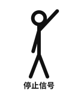 | 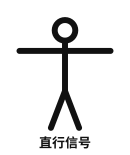 | 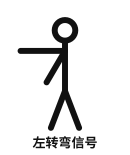 | 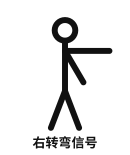 |
| 左臂向前上方直伸 | 两臂左右平伸 | 右臂前平伸，左臂向右前方摆动 | 左臂前平伸，右臂向左前方摆动 |

## 3. 交通标志分类
| 类型 | 颜色与形状 | 作用 |
| --- | --- | --- |
| 警告标志 | 黄底、黑边、黑图案，等边三角形 | 警告车辆、行人注意危险 |
| 禁令标志 | 白底、红圈、红杠、黑图案，圆形 | 禁止或限制某种交通行为 |
| 指示标志 | 蓝底、白图案，圆形或矩形 | 指示车辆、行人按规定方向、地点行驶 |
| 指路标志 | 蓝底白字（高速为绿底白字） | 传递方向、地点、距离信息 |
| 旅游区标志 | 棕底白字或图案 | 指示旅游景点方向和距离 |
| 道路施工安全标志 | 黄底黑字或图案 | 提示施工路段 |
| 辅助标志 | 白底黑字，附在主标志下 | 对主标志作补充说明 |

**各类标志示例：**

| 警告标志 | 禁令标志 | 指示标志 | 指路标志 |
| :---: | :---: | :---: | :---: |
| 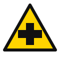 | 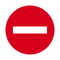 |   | 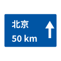 |
| 黄底黑边三角形 | 白底红圈圆形 | 蓝底白图案圆形 | 蓝底白字矩形 |

## 4. 常见禁令标志
- 禁止通行、禁止驶入、禁止机动车驶入。
- 禁止左转弯、禁止右转弯、禁止掉头、禁止超车。
- 禁止停车、禁止长时停车。
- 限速、解除限速、限高、限宽、限重。
- 禁止鸣喇叭。

**常见禁令标志示例：**

| 禁止通行 | 禁止驶入 | 限速 40 | 禁止停车 |
| :---: | :---: | :---: | :---: |
|  | 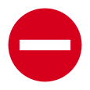 | 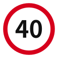 | 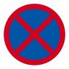 |
| 白底红圈，空白 | 红底白横杠 | 白底红圈黑字 | 蓝底红圈红叉 |

## 5. 道路标线
- **白色虚线**：可跨越，用于分隔同向车流或指示车行道边缘。
- **白色实线**：禁止跨越，用于分隔同向车流或路缘。
- **黄色虚线**：可跨越，用于分隔对向车流。
- **黄色实线**：禁止跨越，用于分隔对向车流。
- **双黄实线**：严禁车辆跨越。
- **黄色虚实线**：实线一侧禁止跨越，虚线一侧允许跨越。
- **导流线**：禁止压线、越线行驶。
- **网状线**：禁止停车。
- **停止线**：车辆等候信号灯时不得越线。
- **人行横道线**：行人优先通行。
- **减速标线**：提示减速。

**常见道路标线示例：**

| 白色虚线 | 白色实线 | 双黄实线 | 导流线 | 停止线与人行横道 |
| :---: | :---: | :---: | :---: | :---: |
|  |  |  |  |  |
| 可跨越同向车道 | 禁止跨越 | 严禁跨越对向车道 | 禁止压线、越线 | 停止线前停车让行 |

---

# 七、灯光使用与仪表警告灯

> 以下图标均为**示意图**，不同车型的图标样式可能略有差异，实际以车辆说明书和仪表提示为准。

## 1. 灯光使用场景

| 场景 | 灯光使用 |
| --- | --- |
| 夜间起步 | 开近光灯 |
| 夜间会车 | 距对向来车 **150 米以外** 改用近光灯 |
| 夜间通过无信号灯路口 | 交替使用远近光灯示意 |
| 夜间超车 | 提前开左转向灯，交替使用远近光灯或鸣喇叭 |
| 雾天行驶 | 开雾灯、示廓灯、前后位灯、危险报警闪光灯 |
| 临时停车 | 开危险报警闪光灯 |
| 牵引故障车 | 牵引车和被牵引车均开危险报警闪光灯 |
| 高速公路能见度 < 100 米 | 开雾灯、近光灯、示廓灯、前后位灯、危险报警闪光灯 |
| 进入隧道 | 开近光灯，不得开远光灯 |
| 夜间在照明良好道路 | 使用近光灯 |

> 远光灯只能在照明不良、没有对向来车的道路使用；会车、跟车、通过路口时不得使用远光灯。
> 在道路上发生故障或事故妨碍交通又难以移动的，应开危险报警闪光灯并设置警告标志。

**指示灯颜色含义：**

- **绿色/蓝色**：功能指示，表示相应灯光或系统正在工作。
- **黄色/琥珀色**：警告提示，应引起注意，尽快检查或维修。
- **红色**：危险警告，应立即停车检查，排除故障后再行驶。

## 2. 常见灯光标志

| 左转向灯 | 右转向灯 | 近光灯 | 远光灯 |
| :---: | :---: | :---: | :---: |
|  |  |  |  |
| 绿色左箭头 | 绿色右箭头 | 绿色，光线向下倾斜 | 蓝色，光线水平 |

| 前雾灯 | 后雾灯 | 示廓灯/位置灯 | 危险报警闪光灯 |
| :---: | :---: | :---: | :---: |
|  |  |  | 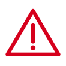 |
| 绿色，光线向下并带波浪线 | 黄色，光线水平并带波浪线 | 绿色，两侧灯光向外照射 | 红色三角形感叹号 |

> 记忆要点：**前雾灯为绿色，后雾灯为黄色**，不要记反。雾天应同时开启雾灯、示廓灯、前后位灯和危险报警闪光灯。

## 3. 常见车内警告灯

**安全与车身类：**

| 安全带未系 | 车门未关 | 安全气囊故障 | 制动系统警告 |
| :---: | :---: | :---: | :---: |
|  |  |  |  |
| 系好安全带后再行驶 | 停车关好所有车门 | SRS 故障，气囊可能失效 | 立即停车检查制动液、手刹 |

**动力与电气类：**

| 发动机故障 | ABS 故障 | 蓄电池充电故障 | 机油压力报警 |
| :---: | :---: | :---: | :---: |
|  |  |  |  |
| 尽快检修，避免大负荷行驶 | 防抱死失效，谨慎驾驶并检修 | 充电系统异常，尽快检修 | 立即停车熄火，检查机油 |

**行驶与温度类：**

| 胎压报警 | 冷却液温度过高 | 燃油不足 | 转向助力故障 |
| :---: | :---: | :---: | :---: |
|  |  |  |  |
| 检查胎压，低速行驶至维修点 | 停车怠速降温，勿立即开水箱盖 | 尽快加油，避免燃油耗尽 | 转向变沉，低速谨慎行驶并检修 |

> 注意：车辆启动时仪表自检，警告灯短暂亮起属于正常现象；行驶中**红色警告灯**亮起应立即靠边停车检查，**黄色警告灯**亮起应尽快检修。ABS 故障时常规制动仍然有效，但紧急制动时车轮可能抱死，应降低车速、加大车距。

---

# 八、让行规则

## 1. 路口让行
- **转弯让直行**：转弯车辆让直行车辆先行。
- **右转让左转**：相对方向行驶的右转弯车辆让左转弯车辆先行。
- **支路让干路**：支路车辆让干路车辆先行。
- **环岛**：进环岛车辆让已在环岛内车辆先行。
- **无信号灯路口**：让右方道路来车先行。
- **有障碍一方让无障碍一方**；有障碍一方已驶入障碍路段而另一方未驶入时，无障碍一方让行。

## 2. 特殊让行
- **行人**：行经人行横道应减速，遇行人正在通过应停车让行。
- **校车**：校车停靠上下学生时，同方向只有一条车道时后方车辆应停车等待；有多条车道时，相邻车道车辆停车等待，其他车道车辆减速通过。
- **特种车辆**：执行紧急任务的警车、消防车、救护车、工程救险车享有优先通行权，其他车辆和行人应让行。
- **山路会车**：下坡车让上坡车先行；但下坡车已行至中途而上坡车尚未上坡时，上坡车让下坡车先行。靠山体一侧车辆让不靠山体一侧车辆先行。
- **超车**：被超车辆在条件允许时应减速靠右让行，不得故意阻碍。

## 3. 不得超车的情形
- 前车正在左转弯、掉头、超车时。
- 与对面来车有会车可能时。
- 前车为执行紧急任务的警车、消防车、救护车、工程救险车时。
- 行经铁路道口、交叉路口、窄桥、弯道、陡坡、隧道、人行横道、市区交通流量大的路段等没有超车条件时。

---

# 九、安全行车与文明驾驶

## 1. 安全距离
- 高速公路车速超过 **100 km/h** 时，与同车道前车保持 **100 米以上** 距离。
- 车速低于 **100 km/h** 时，最小距离不得少于 **50 米**。
- 普通道路应根据车速、路况、天气保持足以采取紧急制动的安全距离。

## 2. 疲劳驾驶
- 连续驾驶机动车超过 **4 小时** 应停车休息，休息时间不少于 **20 分钟**。
- 疲劳时反应迟钝、判断力下降，应尽快到服务区或安全地点休息，不得勉强驾驶。

## 3. 恶劣天气
- 雨天路滑，应降低车速、增大车距，避免急刹车、急转向。
- 雾天开雾灯和危险报警闪光灯，降低车速，必要时驶离道路。
- 冰雪路面应低速行驶，使用防滑链，避免急加速和急制动。
- 大风天气注意横风，双手握稳方向盘，减速慢行。

## 4. 特殊路段
- **隧道**：进入前减速、开近光灯，不得超车、掉头、倒车、停车。
- **桥梁**：注意限重、限高，横风时减速。
- **铁路道口**：一停、二看、三通过，不得抢行。
- **学校区域**：减速慢行，注意儿童。
- **村庄、集市**：减速，注意行人和牲畜。

## 5. 文明驾驶
- 不闯红灯、不逆行、不占用应急车道。
- 不向车外抛撒物品。
- 不随意变道、不强行加塞。
- 遇行人过马路主动礼让。
- 不斗气、不飙车、不酒后驾驶。
- 夜间会车主动改用近光灯。

---

# 十、高速公路行车

- 进入高速公路应通过**匝道**加速，在加速车道上提高车速后驶入行车道。
- 驶离高速公路应提前进入**减速车道**，不得在行车道上突然减速。
- 不得在高速公路上**倒车、逆行、掉头、穿越中央分隔带**。
- 不得在**应急车道**行驶或停车（紧急情况除外）。
- 高速公路**违法停车**记 **9 分**。
- 车辆发生故障时：**车靠边、人撤离、即报警**，在来车方向 **150 米外** 设置警告标志，人员转移到护栏外。
- 高速公路最低时速 **60 km/h**，不得低于规定最低时速行驶。
- 实习期内不得独自上高速，需持相应或更高准驾车型驾驶证 **3 年以上** 的驾驶人陪同。

---

# 十一、交通事故处理

## 1. 事故现场处置
1. 立即**停车**，开启危险报警闪光灯。
2. 保护现场，抢救受伤人员。
3. 迅速报警（122）并通知保险公司。
4. 在来车方向设置警告标志：普通道路 **50—100 米**，高速公路 **150 米以外**。
5. 人员转移到安全地点，避免二次事故。

## 2. 自行协商
- 仅造成**轻微财产损失**，且基本事实清楚、当事人对事实及成因无争议的，可先撤离现场再协商处理。
- 造成人员伤亡的，必须报警，不得逃逸。

## 3. 责任认定
- 公安机关交通管理部门应在勘查现场之日起 **10 日内** 制作交通事故认定书。
- 当事人对认定有异议的，可在收到认定书之日起 **3 日内** 提出复核申请。
- 发生交通事故后**逃逸**的，逃逸方承担**全部责任**；有证据证明对方也有过错的，可以减轻责任。
- 故意破坏、伪造现场、毁灭证据的，承担全部责任。

## 4. 损害赔偿
- 机动车与非机动车、行人之间发生事故，机动车一方承担赔偿责任；有证据证明非机动车、行人有过错的，可减轻机动车一方责任。
- 机动车一方没有过错的，承担不超过 **10%** 的赔偿责任。
- 交通事故损害赔偿争议可申请交警调解，也可直接向人民法院提起民事诉讼。
- 调解申请应在事故认定书送达之日起 **10 日内** 提出，调解期限为 **10 日**。

---

# 十二、机动车与驾驶证业务

## 1. 机动车登记
- 新车应办理注册登记，取得号牌、行驶证后方可上道路行驶。
- 机动车所有权转移应办理转移登记。
- 机动车报废应办理注销登记，不得驾驶报废车上路。
- 机动车应按规定期限进行安全技术检验。

## 2. 号牌使用
- 号牌应按规定悬挂，保持清晰、完整，不得故意遮挡、污损。
- 不得使用伪造、变造的号牌，不得使用其他车辆的号牌。
- 未悬挂号牌或故意遮挡、污损号牌记 **9 分**。

## 3. 驾驶证业务
- 驾驶证遗失可申请补发，补发后原证作废。
- 驾驶证损毁、信息变化应申请换证。
- 驾驶证被依法扣留、暂扣期间不得驾驶机动车。
- 不得将驾驶证转借他人，不得使用伪造、变造的驾驶证。

---

# 十三、紧急情况处置

| 情况 | 正确处置 |
| --- | --- |
| 爆胎 | 双手紧握方向盘，松抬加速踏板，缓踩制动，靠边停车 |
| 制动失灵 | 抢挂低速挡，使用驻车制动，必要时利用障碍物减速 |
| 转向失控 | 立即减速，避免急刹车，靠边停车 |
| 车辆起火 | 立即停车熄火，切断电源，用灭火器灭火，人员撤离 |
| 车辆落水 | 待车内外水压接近时开门或破窗逃生 |
| 发动机熄火 | 开启危险报警闪光灯，靠边停车检查 |
| 高速公路故障 | 车靠边、人撤离、即报警，150 米外设警告标志 |
| 油门卡滞 | 踩下离合器或挂空挡，关闭发动机，靠边停车 |

---

# 十四、易错数字速记

| 数字 | 含义 |
| --- | --- |
| 18 周岁 | C1 最低申请年龄 |
| 12 个月 | 实习期 |
| 6 个月 | 饮酒驾驶暂扣驾驶证期限 |
| 5 年 | 醉驾后不得重新取得驾驶证 |
| 10 年 | 醉驾营运车后不得重新取得驾驶证 |
| 终生 | 酒驾/逃逸构成犯罪后不得重新取得驾驶证 |
| 90 日 | 驾驶证期满前换证时间 |
| 30 日 | 信息变更备案、死亡事故审验期限 |
| 4 小时 | 连续驾驶时间上限 |
| 20 分钟 | 停车休息最短时间 |
| 150 米 | 夜间会车改用近光灯距离；高速警告标志距离 |
| 50—100 米 | 普通道路警告标志距离 |
| 100 米 | 高速车速 >100km/h 时的安全车距 |
| 50 米 | 高速车速 <100km/h 时的最小车距 |
| 120 km/h | 高速公路最高时速 |
| 60 km/h | 高速公路最低时速 |
| 30 km/h | 特殊情况最高时速 |
| 10 日 | 事故认定书制作期限、调解期限 |
| 3 日 | 事故认定复核申请期限 |

---

# 十五、考前提醒

1. **以题带记**：多做真题，错题反复看，重点记数字和处罚档次。
2. **抓大放小**：记分、速度、灯光、让行、事故处理是高频考点。
3. **看清题干**：注意“正确的是”“错误的是”“不得”“可以”等关键词。
4. **不要空题**：不确定时优先选择“安全、礼让、减速、观察”类选项。
5. **关注新规**：记分规则、处罚标准可能调整，以当地最新法规和题库为准。

> 祝考试顺利，一次通过！
